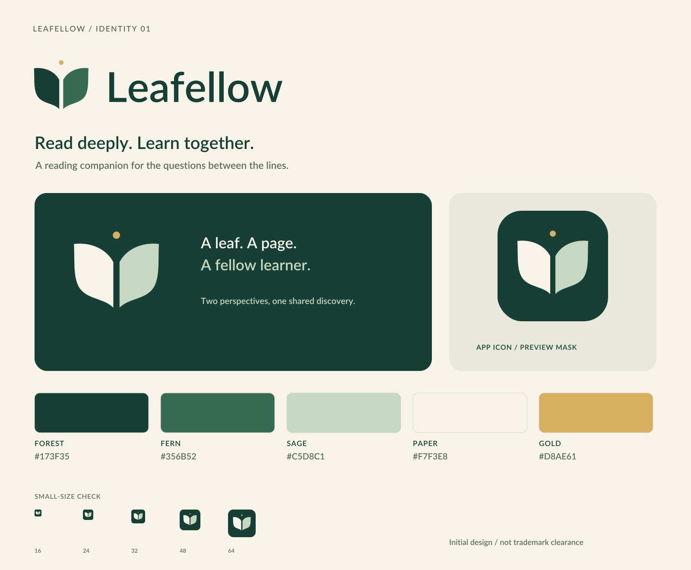

# Leafellow

**Read deeply. Learn together.**



An open-source reading companion for understanding difficult passages, bridging missing foundations, and learning with other readers.

## Status

**Early mobile reader prototype — not a complete e-reader yet.** The shared TypeScript core imports bounded local EPUB/PDF text and source-bound passage selections. An Expo app is scaffolded in `apps/mobile` for Android and iOS, using Expo SDK 58.0.22 and React Native 0.88.1. It implements reflowable-EPUB import, reader selection preview, and single-position local resume metadata in SQLite; the exact same EPUB must be re-selected to resume, and book bytes are not retained by Leafellow. Native runtime behavior remains unverified. Web currently shows a scope notice; saved highlights, PDF rendering, AI/provider integration, and sync are not implemented. Slice 1's feasibility record and remaining limits are documented in Life OS. Brand assets are an initial design, not trademark clearance.

**Slice status:**
- 0b. Local document import: merged (PR #2, green Actions at exact head)
- 1. Requirements and bounded feasibility: design review complete; Android/iOS and Alice's Adventures in Wonderland were selected for the initial mobile EPUB prototype.
- 2. Personal reading vertical slice: approved and in progress; Expo SDK 58 / React Native 0.88.1 app scaffolded. Native device validation is pending.
- 4. Sync and invite-only reading rooms: still awaiting separate approval.

## The idea

Read → highlight a confusing passage → get an explanation or a short prerequisite bridge → check understanding → return to the source. Keep bookmarks, personal annotations and explicitly shared discussion distinct. Private by default; no punitive streaks or whole-book uploads by default.

The first learning scenario is technical reading with gaps in mathematics. Other subjects may follow; building a general curriculum platform is not the starting scope.

## Project documents

- [Product brief](docs/product.md)
- [Roadmap and feasibility gates](docs/roadmap.md)
- [Architecture decisions](docs/decisions.md)
- [Web, Android and iOS architecture proposal](docs/cross-platform.md)
- [Required EPUB and PDF format scope](docs/formats.md)
- [Initial delivery contract](docs/kickoff.md)
- [Annotation core: first TDD slice and observed evidence](docs/annotation-core.md)
- [Document import: real-byte parsing, safety limits and TDD evidence](docs/document-import.md)
- [Brand guidelines](brand/README.md)
- [Contribution guide](CONTRIBUTING.md)
- [Security reporting](SECURITY.md)

## Check the foundation and annotation core

Use Node.js 24+ (Node 24 and 26 are CI targets), pnpm 10.29.3 and Python 3.10+.

```sh
pnpm install --frozen-lockfile
pnpm typecheck
pnpm --filter @leafellow/mobile typecheck
pnpm test
python3 -m unittest discover -s tests -v
```

GitHub Actions checks the foundation and core/mobile types on Node 24 and 26, verifies Expo SDK compatibility, and runs the iOS Simulator build/launch smoke workflow on macOS. The iOS workflow is configured but has not yet run on GitHub; no local Xcode/Android SDK is available on the development host.

Rebuild the brand assets (Python 3.10+, Cairo system library, and a local Lato Semibold font):

```sh
uv run --with cairosvg==2.9.1 --with fonttools==4.68.0 python scripts/build_brand.py --font /path/to/Lato-Semibold.ttf
```

The default font path targets a standard Linux `fonts-lato` installation. Fonts and the Cairo system library are not bundled. Tests use the Python standard library and do not need rendering dependencies. Raster bytes can vary with Cairo/font versions; regenerate and review the manifest when intentionally changing the renderer.

## License and identity

Code and non-brand documentation: [Apache License 2.0](LICENSE).
Original name/logo/icon artwork and brand tokens/previews under `brand/` are excluded from the Apache grant; see [brand-use terms](BRAND_LICENSE.md). This separation allows open-source software without granting permission to impersonate the project. It is not a claim of a registered trademark or a resolution of legal ownership outside this repository.

Project hosted by [reallyenglish-global](https://github.com/reallyenglish-global). Hosting and licensing decisions do not themselves settle employment/IP agreements. No third-party provider affiliation is implied.
